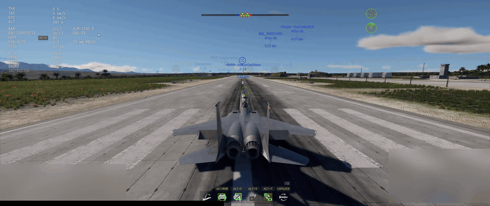
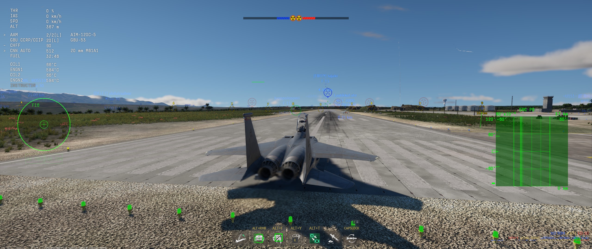
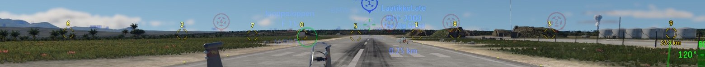
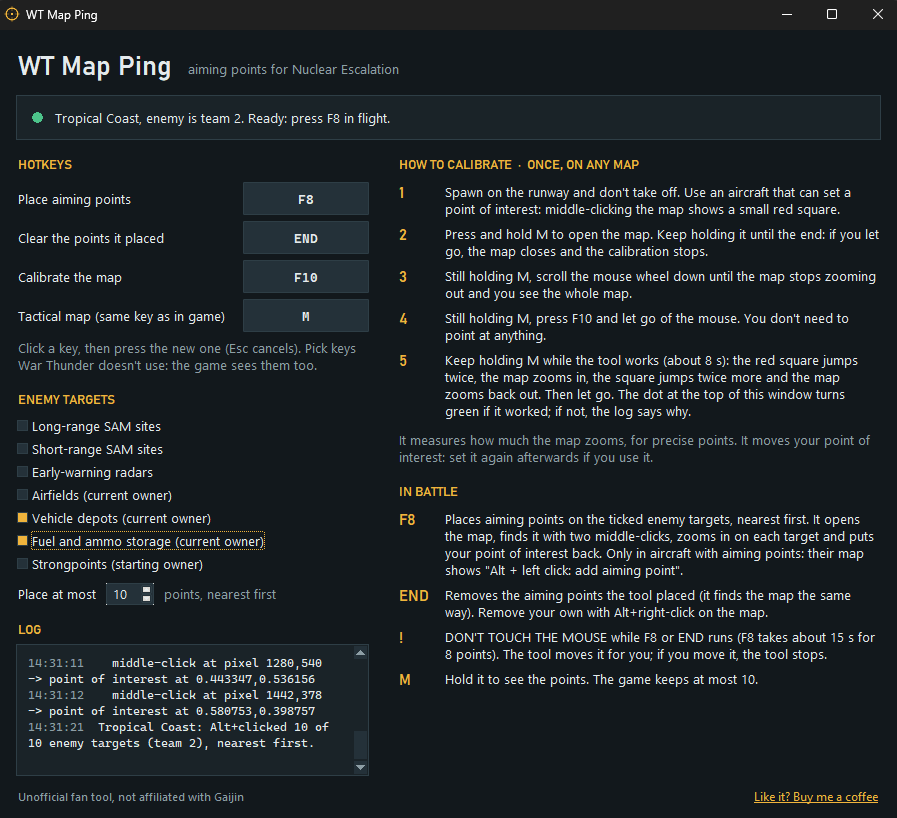

# WT Map Ping

Mark every enemy SAM site in War Thunder's **Nuclear Escalation** mode with one key press, and radars, depots, airfields and other targets too.

WT Map Ping opens the tactical map and **Alt+clicks each target** for you, nearest first. On aircraft with aiming points, each click adds an aiming point. The positions come straight from the game's mission files, so the points land on the targets even though enemy SAM sites are hidden on your map.

[](docs/demo.mp4)

*One F8 press on the runway: the tool opens the map, places ten aiming points on enemy depots and closes it again. [Full-quality clip (MP4)](docs/demo.mp4)*

[](https://buymeacoffee.com/lorenzogt)

> [!WARNING]
> This is an unofficial fan tool, not affiliated with or endorsed by Gaijin Entertainment. It sends simulated mouse and keyboard input to the game, which Gaijin's rules forbid. Read [Is this allowed?](#is-this-allowed) before you use it.

## The technique

Aiming points let GNSS-guided weapons such as the GBU-53 or the SPICE 250 hit spots you can't see, for example SAM sites hidden on your map. This video by Tony shows the technique the tool automates:

[](https://www.youtube.com/watch?v=hQVXcVz0J9A&t=245s)

[Nuclear Thunder Ultimate SPICE 250+GBU 53 SEAD Quick Guide](https://www.youtube.com/watch?v=hQVXcVz0J9A&t=245s) (starts at 4:05). Instead of looking up each target and Alt+clicking it on the map by hand, you press F8.





## Contents

- [The technique](#the-technique)
- [Features](#features)
- [Requirements](#requirements)
- [Installation](#installation)
- [Quick start](#quick-start)
- [The window](#the-window)
- [Calibration](#calibration)
- [Placing aiming points](#placing-aiming-points)
- [Clearing aiming points](#clearing-aiming-points)
- [Target types](#target-types)
- [Accuracy](#accuracy)
- [How it works](#how-it-works)
- [Files](#files)
- [Troubleshooting](#troubleshooting)
- [Is this allowed?](#is-this-allowed)
- [Credits](#credits)
- [Support](#support)
- [License](#license)

## Features

- **One key for every target.** Press F8 and the tool opens the map, finds exactly where it is, zooms in on each enemy target you chose and Alt+clicks it (up to 10, the game's aiming-point limit), then closes the map.
- **Precise.** After a one-time calibration, points land within tens of metres of their targets: close enough for GNSS-guided bombs on single buildings. See [Accuracy](#accuracy).
- **One key to clear them.** Press End and the tool removes the aiming points it placed. War Thunder itself has no key that removes them all.
- **Nothing to pick by hand.** The tool reads your map and side from War Thunder's built-in local map page (`http://127.0.0.1:8111`). Mirrored matches, where the teams swap sides, are detected too.
- **Exact positions.** Targets come from the community [Nuclear Thunder Interactive Map](https://majorlier.github.io/nuclear-thunder-interactive-map/), which is datamined from the game's mission files.
- **Many target types.** SAM sites, early-warning radars, airfields, vehicle depots, fuel and ammo storage and strongpoints. Captured airfields, depots and storage are tracked live.
- **A small settings window.** Change hotkeys and targets with a click, with the calibration steps on screen. Everything is saved for the next start.
- **No dependencies.** One Python file using only the standard library.

Supported maps: **Tropical Coast**, **Southeastern City** and **Volcano Valley**.

## Requirements

- **Windows 10 or 11.**
- **War Thunder**, the PC client.
- **Python 3.8 or newer**, free from [python.org](https://www.python.org/downloads/). [Installation](#installation) shows how, step by step. Nothing else needs installing.
- **An aircraft with aiming points**, to place them. On the tactical map these aircraft show the *Alt + left click: add aiming point* hint.
- **An aircraft that can set a point of interest** by middle-clicking the map: a red square appears where you click. Most jets with a targeting pod can. Calibration needs it, and F8 and End use it to find the map. In an aircraft without one, they assume the map is where they last found it.
- **War Thunder sharing its map objects** on its local map page, which the tool reads. Since late 2026 the game often serves that page empty. Players report it fills again while the **War Thunder Assistant** phone app is connected to the game ([forum thread](https://forum.warthunder.com/t/the-response-for-127-0-0-1-8111-map-obj-json-in-the-webui-is-empty/355087)). The tool tells you when this happens.
- **War Thunder's *Hold the tactical map button* option left on** (the default). With it off, the map key toggles the map, and the tool's own key press can close the map instead of opening it.

## Installation

You need two things: Python, which runs the tool, and the tool itself. If you already have Python from python.org, skip to step 2.

### 1. Install Python (once)

1. Open [python.org/downloads](https://www.python.org/downloads/) and click the big yellow **Download** button. It downloads the **Python install manager**.
2. Run the downloaded file and click through it with the default options.
3. Open the Start menu, type `cmd` and press Enter. A black **Command Prompt** window opens.
4. Type `py` and press Enter. The first time, this downloads and installs Python itself, which takes a minute. When you see `>>>`, Python works: type `exit()`, press Enter and close the window.

The older **Windows installer** on python.org works too. Keep its default options; the *py launcher* option must stay ticked.

Other Python builds, such as the Microsoft Store's "Python 3.x" or MSYS2, can lack parts the tool needs.

### 2. Download the tool

1. On this page, click the green **Code** button, then **Download ZIP**.
2. Right-click the downloaded ZIP, choose **Properties**, tick **Unblock** at the bottom if it is there, and click **OK**. This stops Windows from warning about every file inside.
3. Right-click the ZIP, choose **Extract All...**, and pick a folder you will find again, for example your Documents.

If you use git: `git clone https://github.com/lorenzoGT2007/WT_map_ping.git`

### 3. Start it with WT Map Ping.bat

Open the extracted folder and double-click **`WT Map Ping.bat`**. The WT Map Ping window opens; no console window stays open. Leave it running while you play. It opens even while War Thunder is closed, and the status card just waits for the game.

The `.bat` file is a tiny launcher. Open it with Notepad to see everything it does: it checks that Python's `pyw` command exists and starts `wt_map_ping.py` with it.

```bat
@echo off
rem Double-click to start WT Map Ping without a console window (needs Python from python.org).
where pyw >nul 2>nul && (start "" pyw "%~dp0wt_map_ping.py" & exit /b)
echo WT Map Ping needs Python. Get it from https://www.python.org/downloads/ (see Installation in README.md).
pause
```

> [!NOTE]
> **Windows or your antivirus may warn about the `.bat` file.** Batch files downloaded from the internet often trigger Windows SmartScreen ("Windows protected your PC") or an antivirus prompt. The tool itself can be flagged too, because it watches for its hotkeys and sends mouse and keyboard input, which is also what macro tools do. If you trust it after reading the files:
> - **SmartScreen:** click **More info**, then **Run anyway**.
> - **"The publisher could not be verified":** click **Run**.
> - **Antivirus:** allow the file or the folder in your antivirus.
>
> Everything is plain text you can read: `WT Map Ping.bat` and `wt_map_ping.py`. The tool only talks to War Thunder's own map page on your PC (`127.0.0.1:8111`) and downloads the target data from the [interactive map](https://majorlier.github.io/nuclear-thunder-interactive-map/).

Other ways to start it, if you prefer:
- Double-click `wt_map_ping.py`, if `.py` files open with Python on your PC.
- Run `py wt_map_ping.py` from a Command Prompt in the tool's folder. It shows errors there, which helps if the window never appears.

On the first start, the tool downloads the target data (about 4 MB) from the interactive map. It refreshes the data once a day and keeps a copy, so it still works if the website is down.

## Quick start

1. Start **WT Map Ping** and leave its window open.
2. Join a **Nuclear Escalation** battle in an aircraft. The window's status card shows the map and the enemy team.
3. **Calibrate once, on any map.** Spawn on the runway, hold **M** and keep holding it, scroll the mouse wheel down until the **whole map** is visible, then press **F10** and let go of the mouse. Keep holding M for about 8 seconds, until the map has zoomed in and back out, then let go. The window shows these steps too; see [Calibration](#calibration).
4. **Press F8** and **don't touch the mouse** until it's done, about 15 seconds for 8 targets. The tool Alt+clicks every chosen enemy target. Hold M to see the new aiming points.
5. **Press End** when you want those points gone. Again, hands off the mouse until it's done.

The game keeps at most 10 aiming points, so clear old ones before step 4.

## The window



| Part | What it does |
|---|---|
| **Status card** | Shows what the tool sees: whether War Thunder is running, the map, the enemy team, and whether the tool is calibrated. It updates every 2 seconds. The dot is grey while waiting, amber until the tool is calibrated with precise clicks on, green when ready, and red when something is wrong. |
| **Hotkeys** | Click a button, then press the new key. Esc cancels. **Place aiming points** defaults to F8, **Clear the points it placed** to End and **Calibrate the map** to F10. **Tactical map** must be the same key as your in-game *Tactical map* bind, default M. Pick keys War Thunder doesn't use, because the game sees them too. Alt, the Windows key and Pause can't be hotkeys, and left and right Ctrl or Shift count as different keys. |
| **Enemy targets** | Tick the target types you want, and choose how many points to place at most (1 to 10). The nearest targets are used first. |
| **How to calibrate** and **In battle** | A step-by-step guide, written with your current keys. |
| **Log** | Everything the tool did, including each calibration reading. |

Settings are saved in `settings.json` as soon as you change them. You can also edit that file by hand while the tool is closed. Key settings are [Windows virtual-key codes](https://learn.microsoft.com/windows/win32/inputdev/virtual-key-codes) written as whole numbers, for example 119 for F8. If the file is broken, the tool falls back to the defaults.

Hotkeys only work **while War Thunder is the active window**, so pressing F8 in a browser does nothing.

## Calibration

Calibrate **once, on any map**. It measures how much the map zooms in per mouse-wheel notch, which F8 needs for its precise clicks. Without it F8 still works, with plain, less precise clicks (see [Accuracy](#accuracy)).

1. **Spawn on the runway** and don't take off. Use an aircraft that can set a point of interest: middle-clicking the map shows a small red square.
2. **Press and hold M** to open the map. Keep holding it until the end: if you let go, the map closes and the calibration stops.
3. Still holding M, **scroll the mouse wheel down until the map stops zooming out** and you see the whole map.
4. Still holding M, **press F10** and let go of the mouse. You don't need to point at anything.
5. **Keep holding M while the tool works** (about 8 seconds). The red square jumps twice, the map zooms in, the square jumps twice more and the map zooms back out. Then let go. The window's status dot turns green if it worked; if not, the log says why.

The tool first finds the map with two middle-clicks, the way F8 does (see [Placing aiming points](#placing-aiming-points)). Then it zooms in a few wheel notches and middle-clicks twice more. From where the point of interest lands, it works out how much the map grew and checks that it grew around the cursor.

**Things to know:**

- A new calibration replaces the old one as soon as it starts, so if it fails, the dot turns amber.
- **Why the runway:** the plane stands still there, so you can take your time, and the point of interest stays put while the tool reads it back. In flight it wobbles slightly.
- If the log says no point of interest appeared and your aircraft can set one, put the cursor on your plane before pressing F10. The tool then tries there too.
- Calibration **moves your point of interest**. If you bomb in CCRP mode with a point of interest set, set it again afterwards.
- The result is stored in `calibration.json` and works for all maps and aircraft. Calibrate again only if F8's points start missing.

## Placing aiming points

Press **F8**, best before take-off. The tool:

1. reads the map, the enemy side and your position from the game,
2. opens the tactical map (holding M yourself works too) and zooms it all the way out with 80 quick wheel notches, enough even from the closest zoom,
3. **finds the map**: it middle-clicks two spots near the middle of the screen and reads back where the point of interest landed. That shows exactly where the map is right now. The zoomed-out map is not always in the same place (it shifts a little depending on where you spawned), so the tool measures it every time,
4. for each chosen enemy target, nearest first: zooms in on it, Alt+left-clicks it and zooms back out, about 1.3 seconds per target,
5. puts your point of interest back where it was, and checks with that click that the map did not move meanwhile. If you had no point of interest, it clicks the second finding spot again just for the check, and leaves the point of interest there,
6. closes the map again.

In all it takes about 15 seconds for 8 targets.

**Don't touch the mouse while F8 runs.** The tool moves the cursor itself, so a nudge would send the next click to the wrong spot. If you move the mouse, release the map key or switch away from the game, the tool stops at once and reports how many clicks it made.

Before you calibrate, or if the calibration could not measure the zoom, F8 clicks the zoomed-out map instead: faster (about 0.7 seconds per target) but less precise.

**Things to know:**

- **The game keeps at most 10 aiming points.** Clear old ones first: press End for the tool's points, or Alt+right-click a point.
- **Use an aircraft with aiming points.** On aircraft without them, Alt+clicking the map may send *Attention to the map!* team pings instead.
- **F8 moves your point of interest** while it finds the map, and puts it back at the end. If F8 stops early, the log says your point of interest was moved, so you know to set it again.
- **Targets outside the game window are skipped**, for example in a small game window, and the log says how many.
- **Targets very close together.** If two chosen targets are only a few pixels apart on the map, the second click can land on the first point's icon. The game may then select that point instead of adding a new one.

## Clearing aiming points

War Thunder has no key that removes all aiming points. Its *Delete Aiming Point* control removes one point at a time and has no default key. On the map, Alt+right-click removes the point under the cursor.

Press **End** and **don't touch the mouse** until it's done. The tool opens the map, finds it the same way as F8 and Alt+right-clicks every aiming point it placed in this battle, newest first. Then it puts your point of interest back. Moving the mouse stops it, as with F8.

**Things to know:**

- **Only the tool's own points.** The game's map page doesn't list aiming points, so the tool only knows where it clicked. Remove points you placed by hand with Alt+right-click.
- The tool forgets its points when you leave the battle or close the tool.

## Target types

All targets come from the **enemy** side. You can choose any combination:

| Type | Notes |
|---|---|
| Long-range SAM sites | 3 per side; one point at the centre of each battery |
| Short-range SAM sites | 5 per side; the nearby SPAA covers belong to the same battery |
| Early-warning radars | 3 per side |
| Airfields (current owner) | Read live from the game's map, so captured airfields are handled |
| Vehicle depots (current owner) | 6–7 per side; the owner comes from the depot's live map icon, so captured depots are handled |
| Fuel and ammo storage (current owner) | 4–6 per side; the owner comes from the live map icon, as with depots |
| Strongpoints (starting owner) | 7–8 per side; the AI can capture them, but the game shows no icon for them, so the tool uses the side that owns them at the start |

Positions are the fixed spots from the mission files. If a depot or storage icon is missing, the tool falls back to the side from the mission file. Destroyed targets are still marked, because the game does not reveal hidden enemy units.

TBM and MLRS launchers are not offered. They drive kilometres away from where they spawn, so a fixed point would be wrong most of the time.

## Accuracy

The target positions are exact: the website's coordinates match the game's own map data to within a metre or two.

The limit is the click itself: a click lands on a whole screen pixel. On the zoomed-out map one pixel is a lot of ground. On a 2560×1080 screen Southeastern City's map is about 840 px wide, so 1 px is about 156 m, and a plain click can land up to about 110 m from its target. Tropical Coast is twice as large, so twice that. That is fine for a SAM battery a few hundred metres across, but it misses a single ammo or fuel storage building.

So once calibrated, F8 zooms in on each target before clicking. At, say, 5× zoom a pixel covers a fifth of the ground, and points land within about 25 m on Southeastern City and 50 m on Tropical Coast. After calibrating, the log shows the zoom and the precision for that map.

F8 also finds the map anew every time. The zoomed-out map is not always in the same place: it shifts and changes size slightly depending on where you spawned. A position measured once would put points hundreds of metres off after the next spawn.

If F8's points still miss, raise `SETTLE` at the top of `wt_map_ping.py` (the zoom animation may need longer on your PC). For a closer zoom, raise `ZOOM_IN_NOTCHES` and calibrate again.

## How it works

- **Map and side detection.** War Thunder serves its map data at `http://127.0.0.1:8111` (`map_info.json`, `map_obj.json`). The tool finds the map by matching the airfields the game shows with the airfields in the mission data. It finds the enemy side from your own SAM sites, which your map always shows and which never change hands. Airfield colours only break ties, because airfields can be captured.
- **Coordinates.** World positions `(x, z)` become fractions of the game's map image: `u = (x − minX) / (maxX − minX)`, `v = (maxZ − z) / (maxZ − minZ)`. The bounds come from `map_info.json`.
- **Finding the map.** The point of interest is the only clicked position the game reports back, so two middle-clicks at known pixels give the exact pixel ↔ map transform. The clicks go around the middle of the game window, about a fifth of the map apart. F8 and End do this every time, because the zoomed-out map shifts with the spawn.
- **Calibration.** It finds the map the same way, then makes two more clicks after zooming in to measure the zoom factor.
- **Precise clicks.** The map zooms in around the cursor; the calibration checks this, and if it doesn't hold, F8 uses plain clicks. The tool puts the cursor on the pixel nearest the target and zooms in by a factor Z. The exact target is then Z times its sub-pixel offset away from the cursor. That is a few pixels, which the tool can hit, and the error shrinks Z times.
- **Input.** Standard Windows `SendInput`. Keys are sent as hardware scancodes, because the game reads scancodes, not virtual keys. The cursor is moved with absolute mouse moves so the game registers the new position before each click.
- **Data.** The three standard missions are downloaded from the interactive map. A mirrored mission only swaps the two teams, so the same positions serve both.

## Files

| File | What it is |
|---|---|
| `wt_map_ping.py` | The tool |
| `WT Map Ping.bat` | Double-click launcher; starts the tool without a console window |
| `test_wt_map_ping.py`, `test_snapshot.json` | Self-check: `py test_wt_map_ping.py`. It uses a real capture of the game's map page and sends no input. |
| `docs/` | The screenshots and the demo clip on this page |
| `settings.json` | Your hotkeys and target choices, created when you change something |
| `calibration.json` | The measured zoom, and where each map was last found (used when an aircraft can't set a point of interest) |
| `sites_cache.json` | Cached target data, refreshed daily |

The last three are personal and are not part of the repository.

## Troubleshooting

| Message or problem | What to do |
|---|---|
| `Waiting for War Thunder (its map API at 127.0.0.1:8111 is not answering).` | Start the game. During a battle, http://127.0.0.1:8111 should open War Thunder's own map in a browser. |
| `Not flying in a battle right now (spawn in an aircraft first).` | The hotkeys work only while you fly an aircraft in a battle. |
| `War Thunder is not sharing its map objects right now ...` (and a red status card saying so) | The game serves its map objects page (`http://127.0.0.1:8111/map_obj.json`) empty, so the tool can't see the sides or read back its clicks, and it clicks nothing. Players report the page fills again while the **War Thunder Assistant** phone app is connected to the game ([forum thread](https://forum.warthunder.com/t/the-response-for-127-0-0-1-8111-map-obj-json-in-the-webui-is-empty/355087)). Start the app, connect it to your game, then press the key again. |
| `Could not tell the Nuclear Escalation map or the enemy side from the map objects.` | Only Nuclear Escalation maps are supported. If you changed the ally or enemy colour in the game options, set them back to blue and red. Right after spawning, wait a few seconds. |
| `Not calibrated yet: F8 works, but ...` (status card) | F8 works with plain clicks. [Calibrate](#calibration) once for precise points. |
| `Calibrated without precise clicks (the log says why) ...` (status card) | The calibration could not measure the zoom, so F8 uses plain clicks. Look for the `precise clicks off: ...` line in the log (see below), then calibrate again on the runway. |
| `Your point of interest was moved: set it again if you use it (CCRP).` | F8 or End stopped before it could put your point of interest back. Set it again if you bomb with it. |
| `No point of interest appeared. Use an aircraft ...` (F10) | Use an aircraft whose middle-click on the map sets a point of interest (a red square), and keep the map key held. If it still fails, put the cursor on your plane before pressing F10. |
| `No point of interest appeared, so the tool cannot find the map.` (F8 or End) | Use an aircraft that can set a point of interest at least once on this map. After that, other aircraft use where the map was last found. |
| `No point of interest appeared, so the map is taken to be where it was last time.` | Fine if you spawned in the same place. If the points are off, use an aircraft that can set a point of interest. |
| `Stopped: keep M held (War Thunder in front) until the tool finishes.` | Keep the map key held until the tool is done, and don't switch windows. |
| `Stopped: the mouse moved.` | Let go of the mouse after pressing the hotkey and don't touch it until the tool is done. |
| `The map readings make no sense ...` | Try again, ideally on the runway, with the map zoomed all the way out and the mouse still. |
| `precise clicks off: ...` in the calibration's log lines | The calibration was saved, but F8 will click without zooming in, and the dot stays amber. Try calibrating again on the runway; if the map was still zooming, raise `SETTLE` first. If it keeps saying the map did not zoom evenly around the cursor, your game zooms differently and plain clicks are the best the tool can do. |
| `The map moved while the tool worked, so the points can be off.` (after F8) | Press End, then F8 again, best while standing still on the runway: in flight the map can follow your plane. |
| `The map moved while the tool worked, so a right-click may have missed ...` (after End) | Hold M and remove any aiming point still on the map with Alt+right-click. |
| `... (N skipped: off the game window)` | Those targets would be outside the game window, for example in a small windowed game. Make the window bigger or fullscreen. |
| F8 leaves the map zoomed in | Raise `ZOOM_NOTCHES` at the top of `wt_map_ping.py`, for example to `150`, or scroll the map out yourself before pressing F8. |
| F8's points still miss by more than the log's "points land within about ... m" | Raise `SETTLE` at the top of `wt_map_ping.py`, for example to `1.0`: the map may still be zooming when the tool clicks. |
| `... (stopped: the map closed or War Thunder lost focus)` | Keep War Thunder in front and don't release the map key while the tool works. |
| `... (stopped: the mouse moved; don't touch it while the tool works)` | After F8: press End to remove the points it placed, then F8 again (pressing F8 twice would place the first points twice). After End: press End again. Keep your hand off the mouse until it finishes. |
| `No aiming points placed by this tool to clear.` | The tool only removes points it placed in this battle. Remove other points with Alt+right-click on the map. |
| `WT Map Ping needs Python ...` when you start `WT Map Ping.bat` | Install Python ([Installation](#installation), step 1). If you already did, open the Start menu, search **Manage app execution aliases**, and check that the Python and `pyw` aliases are on. |
| Nothing happens when you start `WT Map Ping.bat` | Open a Command Prompt in the folder and run `py wt_map_ping.py` to see the error. |
| The hotkeys do nothing | War Thunder must be the active window. If you run the game as administrator, run the tool as administrator too. |
| Points land next to the targets | Check the log for "The map moved while the tool worked". If F8 ran while flying, run it again standing still. Otherwise calibrate again, or raise `SETTLE`. |
| Some clicks are missing | At low frame rates, raise `STEP` at the top of `wt_map_ping.py`, for example to `0.1`. |
| `Could not download the map data ...` on the first start | Check your internet connection. If the error mentions certificates, use Python from python.org. |
| `settings.json is invalid ...` | Fix the file or delete it to get the defaults back. |

## Is this allowed?

Probably not. Gaijin's [Terms of Service](https://legal.gaijin.net/en/termsofservice) (EULA section 3.2.3, as updated in August 2026) forbid software that automates gameplay and explicitly name macros and scripts. This tool automates mouse and keyboard input, so using it can break those rules and put your account at risk.

The tool does not read or change game memory or files. It only reads the game's built-in local map page and sends ordinary Windows input. That does not make it allowed. **Use it at your own risk.** The authors accept no responsibility for any action taken against your account.

## Credits

- Target data: the [Nuclear Thunder Interactive Map](https://github.com/majorlier/nuclear-thunder-interactive-map) by majorlier, datamined from War Thunder. The tool downloads it at run time and does not redistribute it; all rights stay with its authors.
- War Thunder is a trademark of Gaijin Entertainment. This project is not affiliated with or endorsed by Gaijin.

## Support

If the tool saves you time, you can [buy me a coffee](https://buymeacoffee.com/lorenzogt). Thank you!

## License

[MIT](LICENSE)
